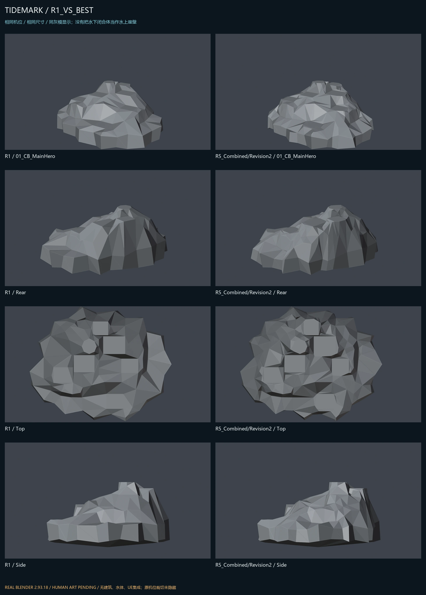
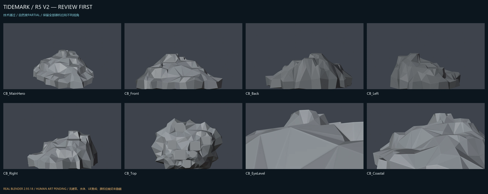
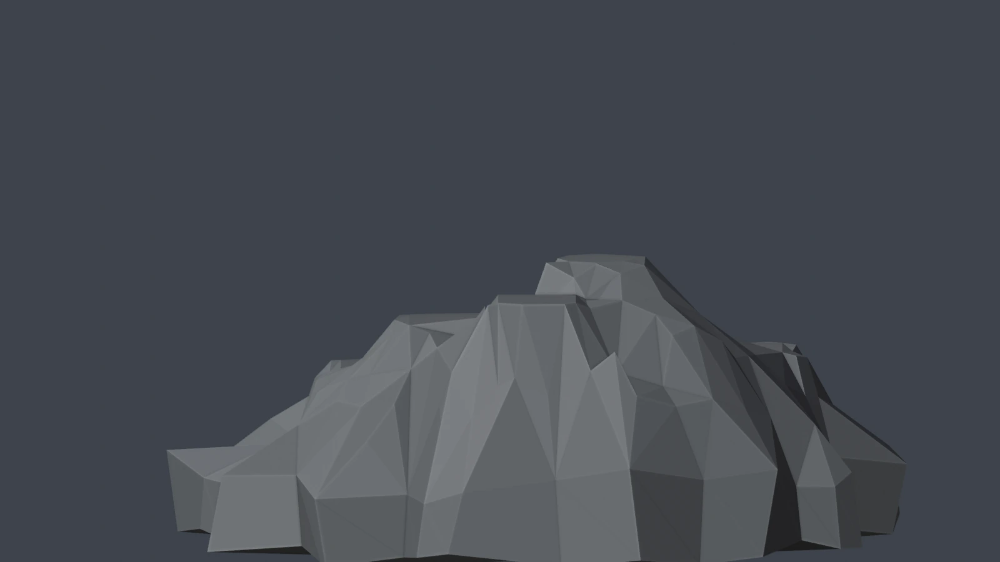
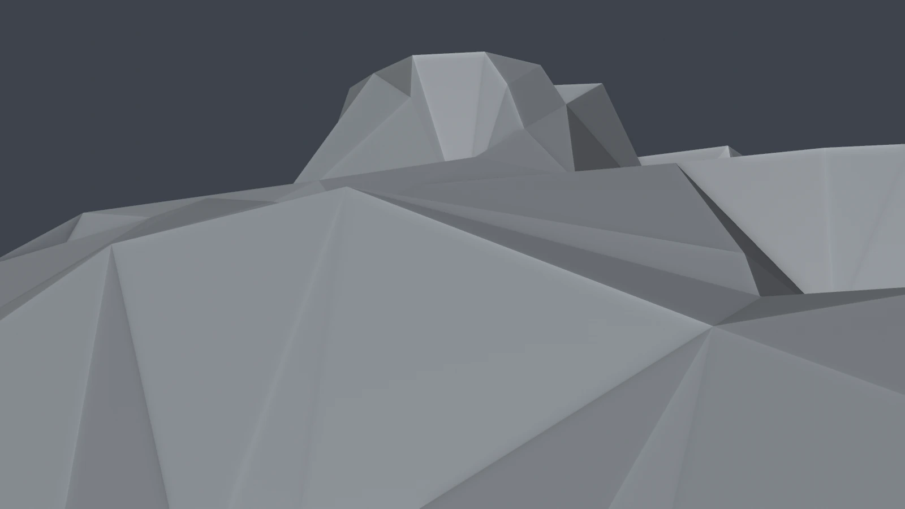

ENVIRONMENT DESIGN × TECHNICAL ART / FIELD NOTES 01

<h1 align="center">T I D E M A R K</h1>

<b>Coastal Worlds, Measured.</b> 岩核、海岸聚落与可验证的实时环境制作

<b>REAL UNREAL ENGINE 5.6.1 CAPTURE</b> · G012 retained visual blockout · Human Art PENDING 真实画面，不是最终环境美术；未 canonical promotion。

<a href="docs/TIDEMARK_PORTFOLIO_TEACHER_BRIEF.md">三分钟项目介绍</a> &nbsp; / &nbsp; <a href="docs/process/08-cb-continuous-rock-research.md">最新岩核研究</a> &nbsp; / &nbsp; <a href="docs/visual-gallery.md">真实 UE / Blender 档案</a> &nbsp; / &nbsp; <a href="docs/status.md">当前状态</a>

## 一座海岛，两种尺度的思考

Tidemark 是个人 **环境设计与 Technical Art** 研究：探索灯塔、低层聚落、岩岸与木栈桥如何组成可信的海岛空间，同时建立可追踪的资产检查、保存重载、固定机位评审与保护回归流程。

**美术目标：** 建筑依附岩岛，灯塔保持主导，栈桥形成前景引导线，保留水面留白。  
**工程目标：** 让设计约束、真实几何、测试结果与人工审查之间的关系清晰可查。

这不是已经完成的 AAA 环境，也不是完全自主制作成品的 AI 系统。Agent 辅助执行；工具产出证据；最终美术判断仍属于 Human Review。

## 01 / 先定剪影，再谈细节

**C+B / B2 连续岩核研究。** 在七个规划区域、路线锚点与前低后高关系不变的前提下，分别研究基础岩肩、面流与岸线，再组合有效变化。不是靠增加面数判定自然度。

| 阶段 | 实际研究 | 边界 |
|---|---|---|
| R1 | 定位大三角坡面、规则承载区与岸脚 | 诊断基线 |
| R2 | 基础外侧非均匀岩肩 | Art PARTIAL |
| R3 | 长边与面流调整 | 局部改善，不代表整体自然 |
| R4 | 岸线、水线与连续岩核 | 独立研究 |
| R5 Revision2 | 组合变化、保存与新进程重载、八机位 | Technical PASS / Art PARTIAL |

[交互页面文件](docs/index.html) · [公开素材哈希与来源](docs/images/overnight-20261018/manifest.json)

> `docs/index.html` 提供响应式页面与 R1/R5 拖动对比。GitHub 文件页不执行 HTML；只有实际 Pages 部署验证后，才会提供上线入口。

## 02 / 保留不好看的角度

原八机位与不利视角一起保留：规则基础面、晶体状折面和水下闭合裙边仍可见，近处岩面也会遮挡原眼高机位。**问题没有被修图隐藏，R5 没有被宣称为美术通过。**

<table><tr><td width="50%">BACK / 规则边缘和大面仍需改善</td><td width="50%">EYE LEVEL / 近面遮挡如实保留</td></tr></table>

## 03 / 把制作过程变成证据

**Human Design → Blender / Python → Geometry QA → Fresh Reload → Fixed-Camera Review → Human Review → UE Integration**

技术步骤及多机位输出已有局部执行证据。Human Art 未通过；**R5 聚落组合和 UE 集成未完成**。

| 技术问题 | 实现方式 | 证据边界 |
|---|---|---|
| 连续岩核是否成立？ | 连通分量、非流形边、退化面、法线与体积检查 | 有限自交检测不是严格无自交证明 |
| 规划落位是否保持？ | 锁定输入与每候选 511 个规划接触采样 | 不等于真实建筑承载、碰撞或可行走 |
| 保存结果是否可信？ | 独立 Blender 进程回读并核对几何签名 | 岩核重载 PASS 不等于聚落已生成 |
| 改动是否值得保留？ | 固定机位、前后对照、不利视角与美术门禁 | 自动技术 PASS 不能代替 Human Art |

[方法、实测结果与限制 →](docs/process/08-cb-continuous-rock-research.md)

## 04 / 真实 UE 接口研究

从登陆空隙、木质连接到建筑基础：使用实际 UE Actor、空间测量和独立保存回读。新视觉组件与 Gameplay Collision 分层；**继承路线测试不能认证新视觉结构可行走**。

[UE 接口案例](docs/process/07-world-art-002-real-ue-engineering.md) · [真实工程图板](docs/process/06-real-engineering-boards.md) · [完整历史档案](docs/visual-gallery.md)

## 05 / 当前真实状态 · 2026.10.18

| 项目 | 状态 |
|---|---|
| G012 | Retained visual baseline，未 canonical promotion |
| R5 岩核 / 独立重载 / 原八机位 | 已有真实技术证据 / Technical PASS |
| R5 岩体自然度 | Art PARTIAL / Human Review PENDING |
| 六房 + TowerProxy 组合 | **尚未生成**；入口已准备，资源门禁阻断 |
| 混元海岸绞盘研究 | **未提交**；余额与计费模式待核验，无资产展示 |
| 正式 UE 场景、Gameplay | 本轮未修改 |
| 下一里程碑 | 受控生成真实聚落组合，检查接地与多机位空间关系 |

## About the work

个人工作围绕空间设计、Blender/Python 几何流程、UE 场景接口、自动化验证与证据整理展开，Agent 辅助编码和执行。EngineeringGuard / RestrictToolbag 展示的是**项目集成与使用**，不冒称独立原创通用产品。

本仓库是精选 Showcase，不包含完整 UE 工程、私有日志、凭据或未审查的第三方源资产。原始 governed concept 未确认公开权利，故不发布原画。新增模型图像为真实 Blender 输出，无 AI 生图替代工程截图。

**工具：** Unreal Engine 5.6.1 · Blender 2.93.18 · Python · FBX · Git · Agent-assisted QA  
**研究方向：** Environment Art · Technical Art · Reproducible Digital Design

Technical evidence is not art approval. Human Art PENDING · No canonical promotion.

