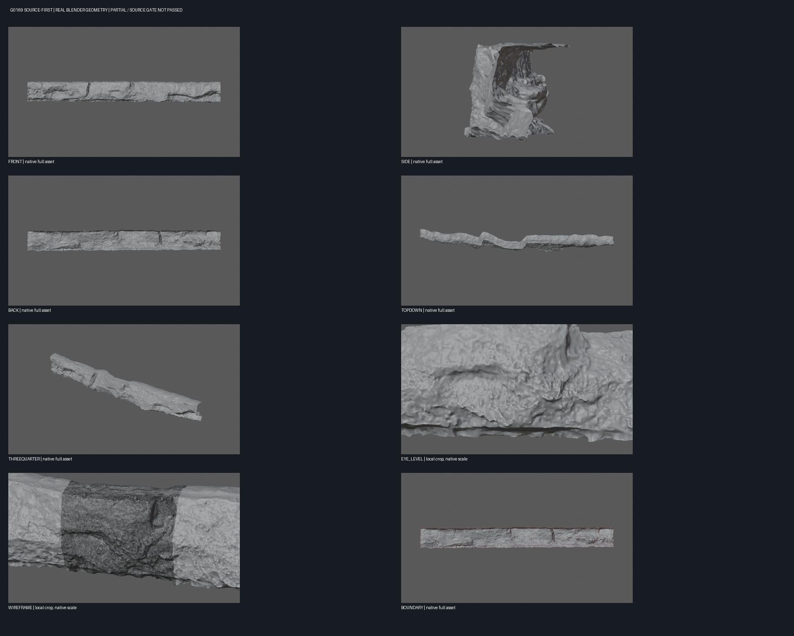
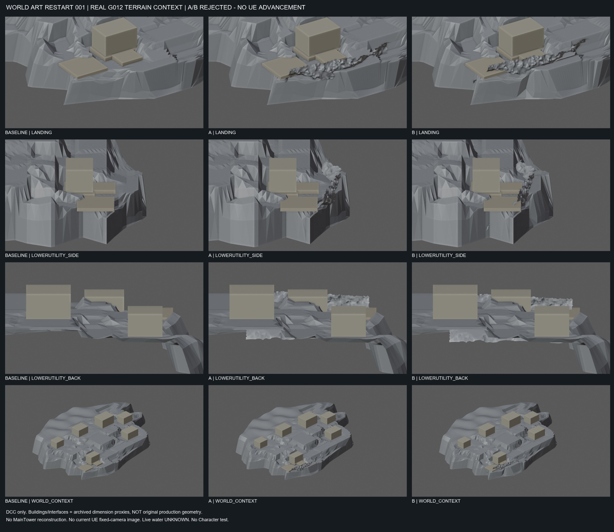

# World Art 002 — Landing to Settlement

**Real Unreal Engine 5.6.1 / Environment Art / Technical Art · October 2026**

> **Result: PARTIAL.** The LowerUtility landing gap has a locally improved **visual connection**. The wider island and settlement are **not** complete. G012 is still the **retained visual baseline**; WART002 is an isolated candidate; Human Art remains **PENDING**. No canonical promotion.

[← Tidemark homepage](../../README.md) · [Earlier rock-form research](06-real-engineering-boards.md)

## 01 · Real UE before and after

The initial landing interface had a **142 cm** edge gap. WART002 adds a **150 × 120 × 14 cm** timber link pitched **3.814°** between old boardwalk and LowerUtility. These values were recorded from actual UE actors and the reloaded candidate, not estimated from the image.

## 02 · Architecture, contact, and camera evidence

The close-ups intentionally retain unfavorable views. Station01 foundation changes are **PARTIAL** rather than complete. The wood link improves the local visual continuity; the eye-height image is a **diagnostic camera**, not player-standing proof.

## 03 · Technical geometry contract

<text> </text>

| Reported measurement / gate | Actual evidence |
| --- | --- |
| Prior landing edge gap | **142 cm** |
| Old boardwalk deck elevation | **165 cm** |
| LowerUtility landing elevation | **175 cm** |
| New timber element | **150 × 120 × 14 cm** |
| New link pitch | **3.8141°** |
| Reloaded box-plane endpoint errors | Approx. **+0.34 cm / +0.09 cm** |
| Newly added isolated modules | **27** total: 20 selective foundations/supports and 7 landing modules |
| G012 source contents | **3,157** actors, including **236** visible graybox architectural modules in six semantic rooms |
| UE save → fresh process → readback | **PASS** |
| Inherited G004 Character route feasibility | **PASS**, inherited collision only |
| Walkability of the **new** visual link | **NOT CERTIFIED** — NoCollision |
| Production source changes / promotion | **0 / none** |
| Human Art acceptance | **PENDING** |

**Engineering nuance:** WART002 measures candidate visual geometry against actual UE actor/component data, and uses new-process readback to verify persistence. Its ACharacter test stays on existing G004 floor authority. That test **does not validate** walking on newly added NoCollision timber or other new visual parts.

## 04 · Research decisions that informed the mainline

These images are genuine research captures but the tested designs were **not** accepted as production assets. They are shown here to document decision quality and the transition away from isolated rock experimentation.

<b>Source-first coastal geology — G0169 (PARTIAL / not retained)</b>

Actual Blender geometry from **[Poly Haven Coastal Cliff 01](https://polyhaven.com/a/coastal_cliff_01)** (CC0). Natural erosion detail improves over the procedural trials, but the long scanned shell has exposed/open side structure; it was **not** qualified as a coherent coast foundation.

<b>Real terrain-context integration A/B — both REJECTED</b>

Actual G012-scale terrain-context experiments showed visible patch ends and inadequate building/shore integration. Rejection happened **before** any protected production map was modified.

## 05 · What a reviewer should understand

This stage demonstrates **environment interface analysis, modular graybox authoring, spatial measurements, fixed-camera review, save/readback verification, separate gameplay authority, and fail-closed asset governance**. It does **not** claim finished shaders, final rock art, final architecture, new collision certification, or a promoted playable level.

**Next intended gate:** develop the LowerUtility landing-to-entrance route in a new isolated candidate, and independently validate visual access and any authorized test collision. No automatic continuation or acceptance is claimed.

**Media provenance:** JPGs are real source screenshot crops or authentic Blender contact sheets. The SVG is an explicit non-scale engineering diagram. No unlicensed reference concept artwork is embedded in the new homepage boards. [Asset provenance manifest](../../media/process/world-art-002-20261011/ASSET_PROVENANCE.json).
