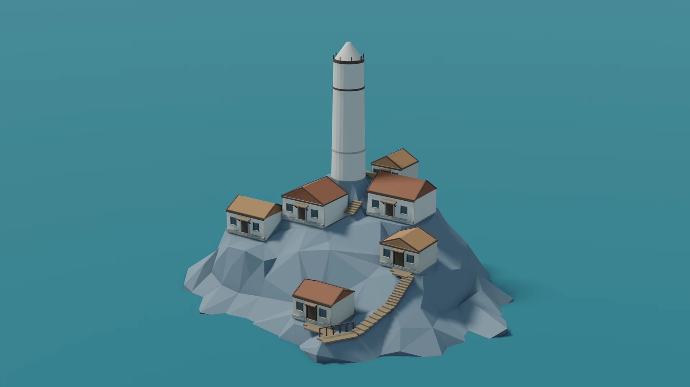
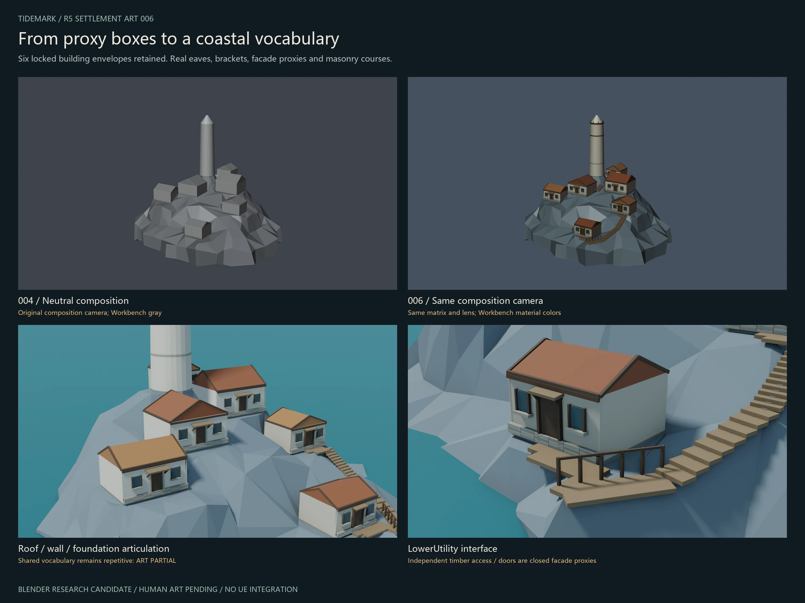
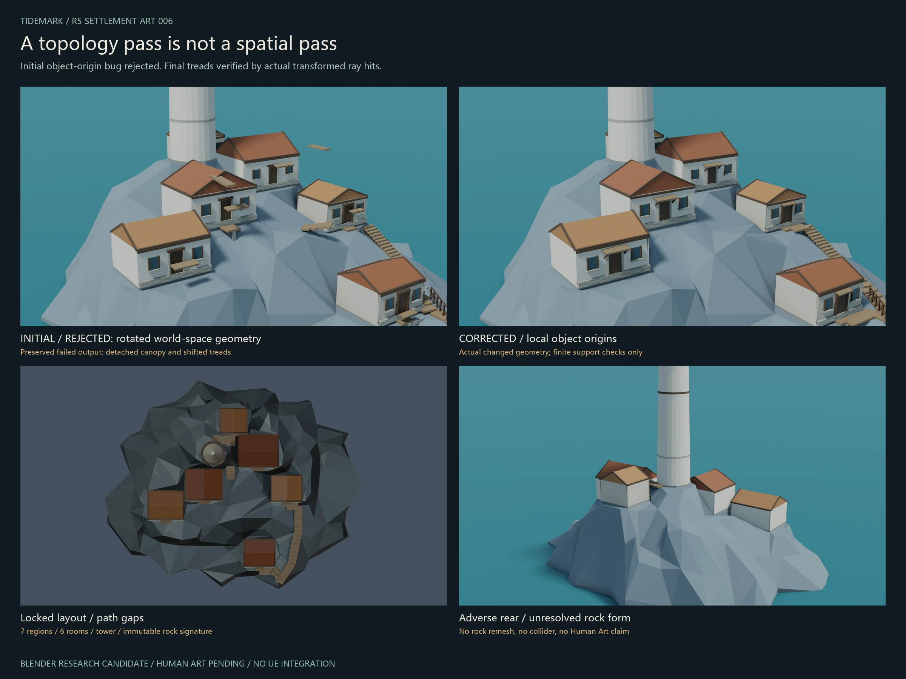
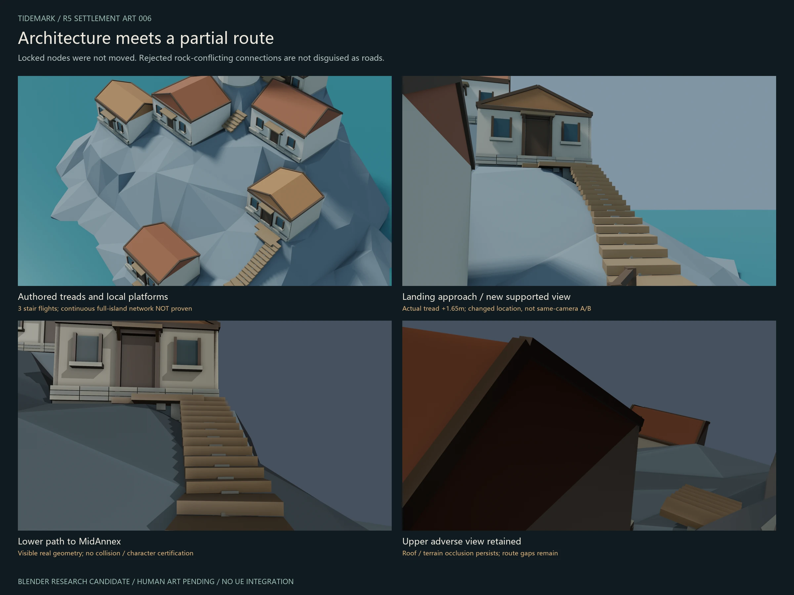
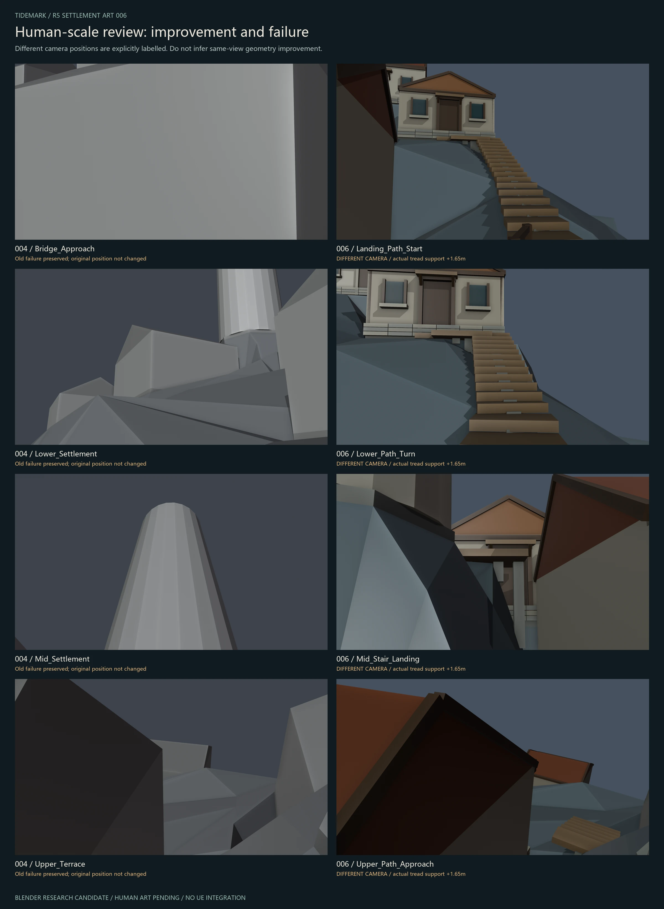

# ROCK × SETTLEMENT — ART DEVELOPMENT

2026-10-19 · Blender Settlement Art LookDev — Research Candidate

**Art PARTIAL / Human Review Pending. Not Final UE5 Environment.**

## What changed

The existing R5 composition was reused, not rebuilt from a new island generator. Six room centers, dimensions, floors, roof ridge directions and seven planning foundations remain locked. The rock's vertices, connectivity and world transform are unchanged. Neutral TowerProxy remains separate from the protected production tower.

Real editable geometry adds eave/gable framing, supported small canopies, facade door/window proxies, masonry plinth courses and local timber access. Three actual stair flights, two entry-branch candidates and a small turning terrace are present. Roof/wall color separation uses self-authored parameter materials, not external textures.

## What failed, and how it was found

The first author's mesh helpers baked global coordinates into vertices. Rotating a canopy or tread therefore rotated it around the world origin rather than its own center. Topology remained valid while objects were spatially wrong. Actual renders exposed detached planks; this first output was rejected and retained as evidence.

The correction creates local-centered geometry, then positions the object. Added tread tests compare actual world centers and downward mesh ray hits with intended top elevations. A separate fresh Blender process verifies the final saved scene, locked objects, original camera matrices and new camera deck support.

## Access is deliberately partial

Six main-route segments encounter rock intrusion under the immutable planning nodes; they were not built as decorative floating paths. Some remaining branches are local fragments, not a continuous settlement network. Isolated route04 / Station00 fragments were excluded from the integrated art render but remain in the earlier research candidate and evidence.

Treads are approximately 0.167–0.175 m high. Two flights have approximately 0.317–0.333 m runs; a lower flight has deeper approximately 0.637 m treads. Widths are 1.20–1.25 m, with one 1.60 m turning platform. These are measured candidate geometry, not approved stairs or structural engineering.

## Cameras and honest comparisons

Original eight cameras and old human review cameras remain unchanged. New art and eye-level cameras are explicitly separate. Each new human camera is supported by an actual modeled tread and placed 1.65 m above it. The new landing and lower-path views read stairs and an entry; middle and upper views still have substantial roof / rock occlusion.

## Evidence boundaries

| Check | Result / scope |
|---|---|
| Editable candidate / fresh reload | Actual separate Blender 2.93.18 process |
| Original rock / locked planning objects | Signature and transform comparison |
| Original cameras | Matrices, projection and lens preserved |
| New geometry topology | Non-manifold / degenerate / volume checks |
| Tread placement | Actual transformed center and mesh ray top checks |
| Rock/support contact | Finite local sampling, not complete intersection proof |
| Human-scale eye height | Actual deck ray hit +1.65 m |
| Collision / Walkability | NOT CERTIFIED |
| UE integration | NOT EXECUTED |
| Human Art / Promotion | PENDING / NO |

The blue-green plane is Blender design water Z=0, not calibrated UE sea level. Eevee daylight and a second warm directional-light study are real renders. No AI scene image, environment retouching, original concept publication, raw model upload or private logs are included.

## Still unresolved

- Six buildings still share a fairly repetitive facade vocabulary.
- The rock remains faceted with recognizable artificial planning shelves.
- Several paths are missing; a complete circulation system is not demonstrated.
- Upper and middle eye-level composition remains weak.
- Door facades are not functioning openings or interiors.

Next is **Human Art Review**, not automatic UE integration or a new production milestone.

[Eight fixed cameras](../images/settlement-20261019/eight-views.webp) · [Image provenance and candidate SHA256](../images/settlement-20261019/manifest.json)
