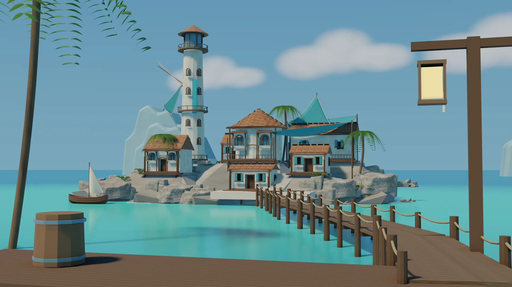
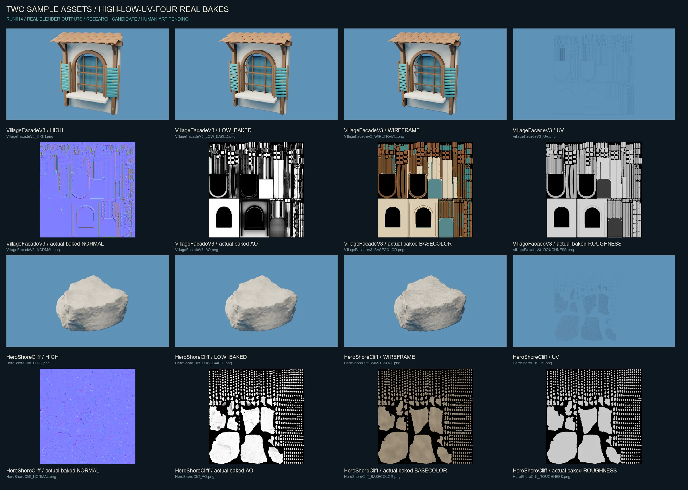

# RUN014 — Environment craftsmanship, with limits

**2026.10.29 · Blender research candidate · ART PARTIAL · HUMAN ART PENDING · PROMOTION NO**

## What changed

The frozen Hero and six building identities were retained. The main and secondary facades now have real arched openings, recessed glazing, separated louvers, sills and a gently cambered timber/tile canopy. Other houses received restrained side/back recesses, eaves and support changes. A separate tower-proxy shaft gained real window recesses; the protected production MainTower was not edited. Local coast/landing interfaces and a small maintenance skiff add harbor context, without resetting the entire island.

## Two asset samples, not an all-scene claim

| Sample | High triangles | Validated low triangles | Actual textures | Remaining limits |
|---|---:|---:|---|---|
| Village Facade | 45,204 | 7,780 | 2048² tangent Normal, AO, color-only Base Color, numerical Roughness | thin projection seams still need visual review |
| Hero Shore Cliff | 64,834 | 13,068 | same four actual bake classes | UV occupancy about28%; 68 sampled overlap pixel centers |

Facade geometry is authored from editable components, not automatic whole-kit decimation. Four zero-area low faces were found and removed in an independent validated copy; surviving UV/material surfaces were retained. The public gallery shows the real V3 bake stage before that zero-area cleanup, not a fabricated new gallery render. The final scene was separately reloaded and rendered after cleanup.

Rock geometry is a retained licensed scan derivative, with a modest pose change and local notch on both high and low. This is not claimed as a newly hand-sculpted asset. UV measurements are pixel-center sampling, not exhaustive overlap or padding certification.

## Evidence and boundaries

The saved final candidate was opened by a new Blender 2.93.18 process, then rendered as Hero, Side, Back, Landing and Eye Level plus a no-DOF diagnostic. Blender FBX parsing and a small editable asset library were independently read back. This does not establish UE import equivalence, collision, navigation, character walking, structural safety or production GPU performance.

Source → High/Low → UV/Bake → Blender QA → fresh reload → fixed-camera evidence are executed in these task-specific workflows. Human Art remains pending. Full UE integration of these candidates was not run. Agent execution does not have final art approval authority.

The rear platform, angular substrate, some rock seams, repeated roof language, palms and cloud/water approximations are still visible. The result is not a finished AAA scene, and it is not promoted over the retained G012 baseline.

## Sources and authorship

- Actual production: Blender2.93.18 and Python automation. Installing another DCC does not constitute using it; no ZBrush/Painter/Marmoset production claim is made.
- New facade components and small harbor props: RUN014 Blender geometry. Inherited scene components originate in earlier Tidemark research.
- Some rock derivatives: [Namaqualand Boulder03](https://polyhaven.com/a/namaqualand_boulder_03), historical source attribution Dario Barresi photography / Jenelle van Heerden model; inherited shoulder [Boulder02](https://polyhaven.com/a/namaqualand_boulder_02), individual author not reconfirmed here. [Poly Haven CC0 license](https://polyhaven.com/license). No endorsement claimed.
- IMA returned an authorization error; no private course was read or represented as a source.
- Human supplied visual direction. Agent assisted isolated geometry/material authoring and validation. No AI image was used as a fake render.

Public media are resized/compressed real Blender frames. Raw models, original concept artwork, private courses, machine logs and credentials are intentionally excluded. [Media hashes](../images/run014/manifest.json).

[Back to showcase](../index.html) · [Historical R5 research](09-r5-settlement-art.md)
