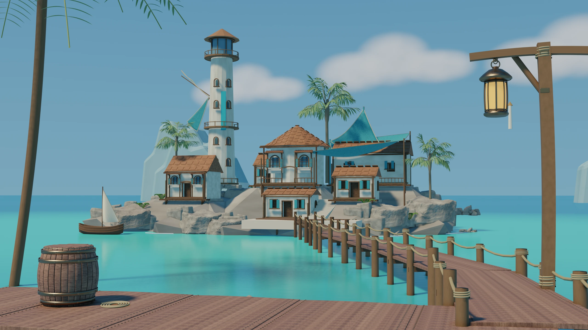
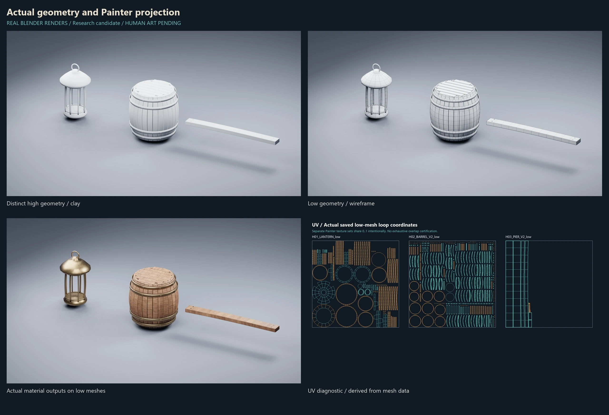
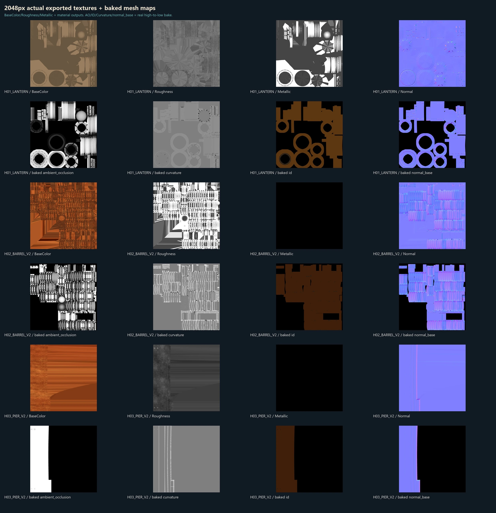
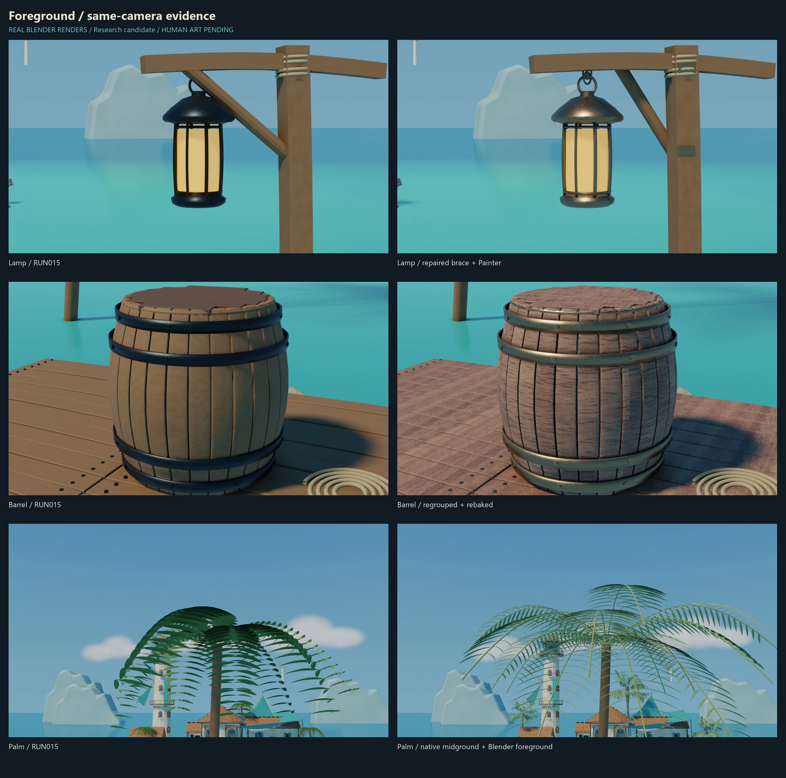
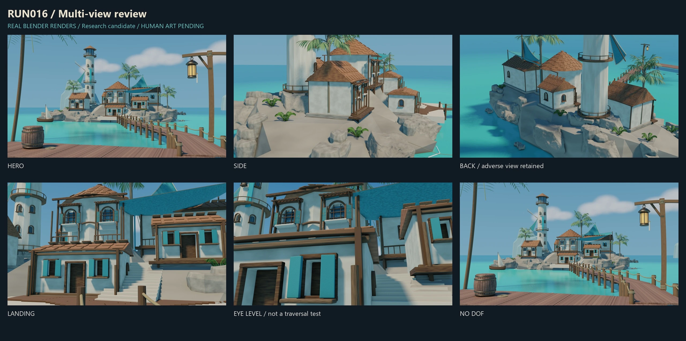

# RUN016 — Foreground assets, real PBR evidence

Research delivery: 30 October 2026. Published: 31 October 2026.

**ART PARTIAL · HUMAN ART PENDING · PRODUCTION PROMOTION NO**

[Live gallery](https://lilith-techart.github.io/Tidemark/#run016) · [Status](../status.md)

## What actually ran

| Asset family | High / low triangles | Executed workflow |
|---|---:|---|
| Lantern | 7,288 / 3,320 | Separate high, low, cage, UV; Painter high-to-low bake; bronze material; native project readback |
| Barrel V2 | 43,712 / 12,976 | Corrected wood/metal assignment by connected component; rebaked; wood and metal material outputs |
| Pier V2 | 2,476 / 548 | Corrected deck/nail material assignment; rebaked; low mesh instanced in scene |

Counts describe the sample assets, not every scene prop. High geometry is a controlled revision of existing sources, not a claim of new manual sculpting. UVs are separated by texture set; exhaustive overlap and texel-density certification were not performed.

Painter produced 2048px tangent-space normal, AO, curvature and ID mesh maps using real high/low and cage inputs, not Low-as-High. Base Color, Roughness, Metallic, Normal and Height material exports are distinct from those mesh maps. Installed Wood Acajou and Bronze Armor smart materials were used, with additional Blender lookdev adjustments; this is not a claim of hand-painted bespoke material authorship.

## Native vegetation and scene integration

SpeedTree 10 was used to edit an installed palm-template derivative: frond frequency, width subdivision, leaf width and asymmetry were changed, a native source saved, and FBX exported. Three midground instances were installed with controlled Blender trunk/crown adjustments. Scene geometry is therefore not byte-identical to the native export. Foreground foliage remains a Blender fallback, not a finished SpeedTree foreground asset. No wind or LOD certification is claimed.

Blender 2.93.18 / EEVEE saved and independently reloaded the final scene, then rendered Hero and diagnostic views. Recorded readback found zero drift across 2,022 scoped source-camera/non-foreground mesh records and 80 packed images, with no unpacked image dependencies in that check.

## Verification boundaries and failures

- Scoped leaf/roof BVH intersection candidates reduced from 36 object pairs to zero after placement fixes. This is a bounded raw-mesh test, not a complete solid-intersection or collision proof.
- Terrain-base vertical samples use explicit terrain meshes; they do not certify structural load or character routes.
- Historical delivery closeout recorded 3,270 protected file hashes unchanged. That is evidence for that run, not a perpetual guarantee.
- An early Painter save/export attempt crashed; later native reopen/export succeeded. Failed artifacts were retained privately.
- SpeedTree UI readback succeeded, but its guarded host timed out before later UI closure; no successful native-host exit code is claimed.
- A SpeedTree autosave sidecar escaped the exact output scope, and two source edits happened after lease expiry. These incidents remain recorded. Subsequent launcher denial prevented DCC spawn, but the entire workflow is **not** described as fail-closed or incident-free.
- IMA authentication failed; no private course retrieval or course-guided authorship is claimed. No general-purpose MCP server is presented as completed.

## Still unresolved

Platform-like island massing, patch-rock seams, simple tower/background shapes, capsule-like clouds, flat water, sparse foreground palm detail and opaque stylized lamp panels remain. Glass physics, global self-intersection, full collision, walkability, UE integration and production performance are not certified.

## Public media provenance

All new gallery images are compressed derivatives of actual RUN016 Blender renders or boards assembled from those renders. UV graphics are analysis derived from real mesh UVs, not a render of an invented model. No AI-generated scene image or reference-art reproduction is included.

Scene lineage includes CC0 Poly Haven Namaqualand Boulder derivatives described in the retained RUN014 credits. Software: Blender, Substance 3D Painter and SpeedTree. Installed commercial templates/materials are shown only through rendered research output; no redistribution right for raw sample assets is asserted, and no native models, textures, SPP/SPM files or course material are distributed here. Human sets the art goals; Agent assists execution and validation; Human Art remains pending.

Public derivative hashes and source-image hashes are listed in [the media manifest](../images/run016/manifest.json). Private source locations, credentials and logs are excluded.
