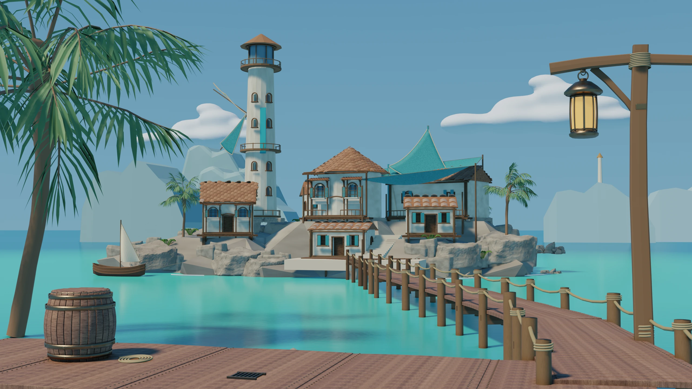
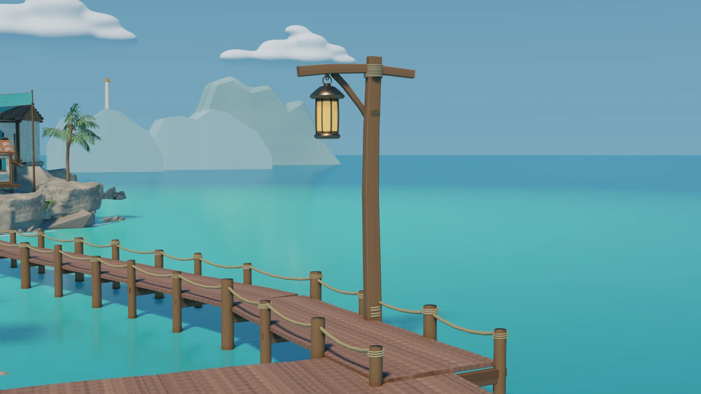
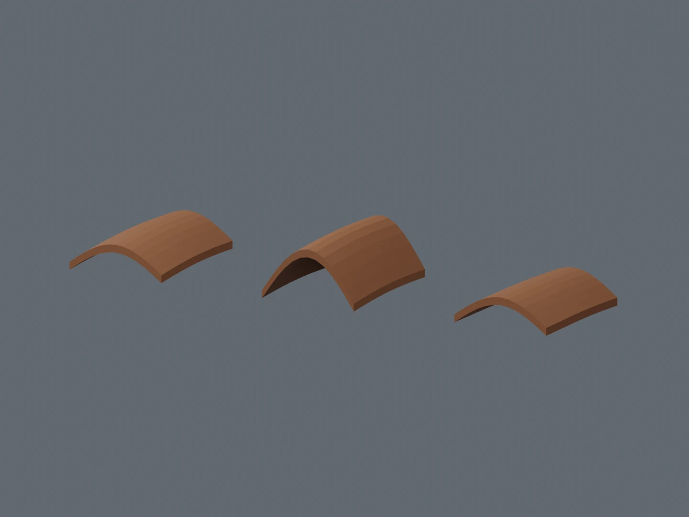
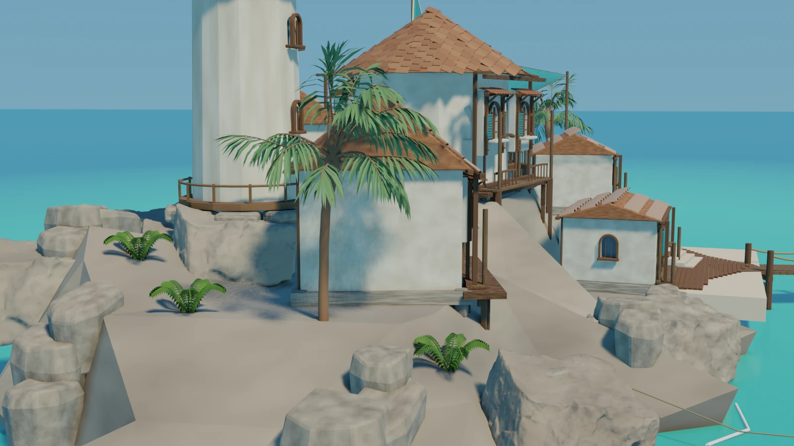
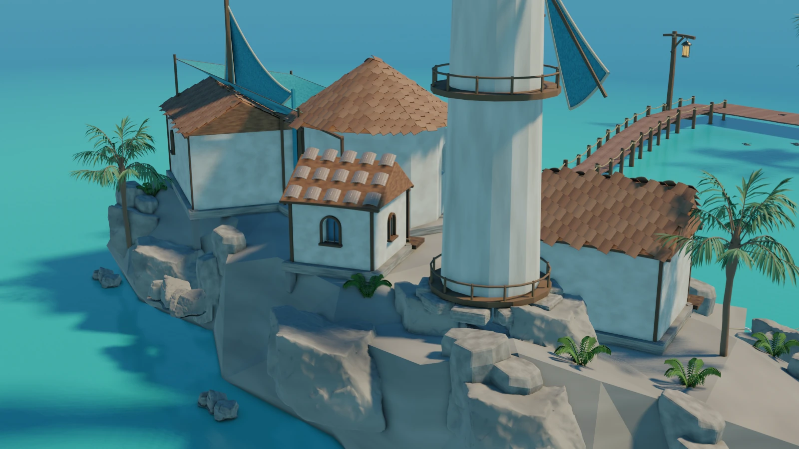

# Selected Visuals — Coastal Worlds, Crafted & Measured

Updated 2026-11-05. **Selected visual is not latest accepted production.**

## What is shown

RUN018 C2_UV_REVIEW, actual Blender 2.93.18 / EEVEE fresh-reload render. The oak appearance is inherited; the rejected cork material is not presented as an improvement. Curved roof modules, arched openings, shutters, timber galleries, lantern and pier are research results, not whole-scene game-ready certification. Images are resized/compressed only, with no generated repaint, geometry retouch or color grading.

## Production research, not a finished environment

Blender asset work, Painter native projects and actual bake/export steps, SpeedTree variants and scene integration exist in the private research archive. These executed steps do not prove accepted asset quality. RUN018's palm close-up and replacement cork look were not accepted; UV, normals and complete support remain limited. Earlier [RUN014 craft](10-run014-environment-craft.md) and [RUN016 asset evidence](11-run016-foreground-pbr.md) remain available with their original scope.

## Keep the adverse views

Artificial platforms, broad slopes, rock seams and incomplete supports remain visible. Later geology experiments have not resolved them. RUN023 retested the same 413 S02 terrain misses and obtained zero remaining misses, but that is coverage, not a complete load path: old posts penetrate the new rock and interface joints remain unverified. Its targeted revision was rejected for winding/overlap risks. **RUN023 ART SELF REVIEW = FAIL**. No LookDev or production promotion follows from those technical results.

**HUMAN ART = PENDING · PRODUCTION PROMOTION = NO.** G012 remains the retained UE visual baseline, not canonical approval. New visual terrain, stairs, collision, walkability, production performance and UE integration are not certified by these Blender renders.

## Publication and attribution

Only authored/assembled scene render derivatives and this summary are published. Earlier rock derivatives include Poly Haven CC0 Namaqualand Boulder sources; see the retained [asset source record](10-run014-environment-craft.md). No raw third-party asset, private reference artwork, course text, native project, credential or machine log is distributed. This is not a declaration of ownership of third-party material or a new license for source assets.

[Image hashes and transformations](../images/selected-20261105/manifest.json) · [Current status](../status.md)
