# Tidemark — Visual & Technical Art Gallery

<strong>UE5 Environment Production Pipeline & Validation System</strong> Real captures · traceable experiments · visual research and technical evidence

  
  
  

> **Scope:** A curated gallery of **already public, genuine Tidemark project captures**. The screenshots and diagram boards below come from archived UE/Blender research; they do **not** imply final art approval, a universal Validator, or production promotion. New October audit results are summarized in the [portfolio context](#pipeline--validation-story), not presented as new engine captures.

## New · Art Direction Research (2026-10-16)

**Chosen art direction: C — fantasy concept composition × AAA real-time production.** The October Art Direction audit is complete, but detailed art lock and the ART-P1 massing choice still require human approval. No new UE or Blender artwork was produced in that audit.

  <a href="../media/showcase/2026-10/tidemark-art-direction-gap-study.svg">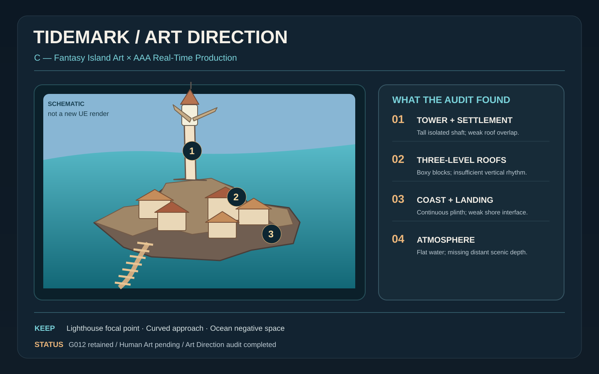</a>
   <b>Visual gap study — original infographic.</b> Derived from the October evidence-backed gap audit. Illustration is schematic, <b>NOT</b> an Unreal Engine capture or a reproduction of the governed reference image.

  <a href="../media/showcase/2026-10/tidemark-art-p1-massing-directions.svg">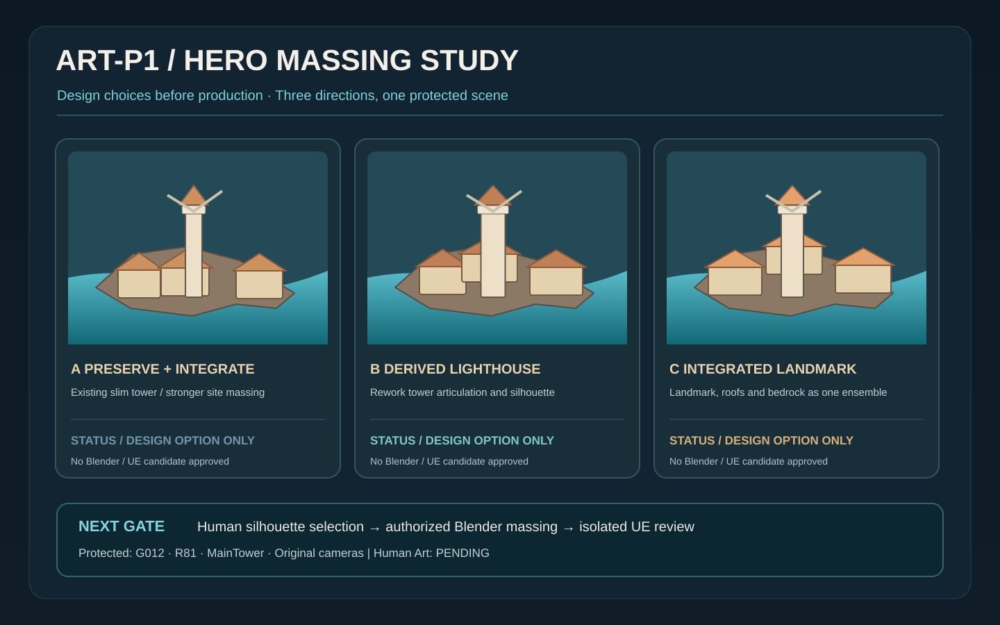</a>
   <b>Hero massing research directions — design diagram.</b> A: preserve &amp; integrate, B: derived lighthouse, C: integrated landmark. These are planning directions, <b>not completed 3D candidates</b> and not human-approved outcomes.

**Original local review materials:** `TIDEMARK_ART_DIRECTION_LOCK_001` supplies a 12-dimension comparison, Style Bible and composition proposal. The complete visual-gap board includes a governed concept image whose public distribution rights are currently unverified, so it is intentionally **not copied** to this public repository. G012 remains retained, R81 remains canonical/read-only, and Human Art remains pending.

---

## 01 · Retained visual baseline — G012

  
   <b>G012 / fixed C027:</b> retained visual baseline. Protected tower, boardwalk relationship and environment massing. <b>Human Art: PENDING.</b>

<table>
<tr>
<td width="50%">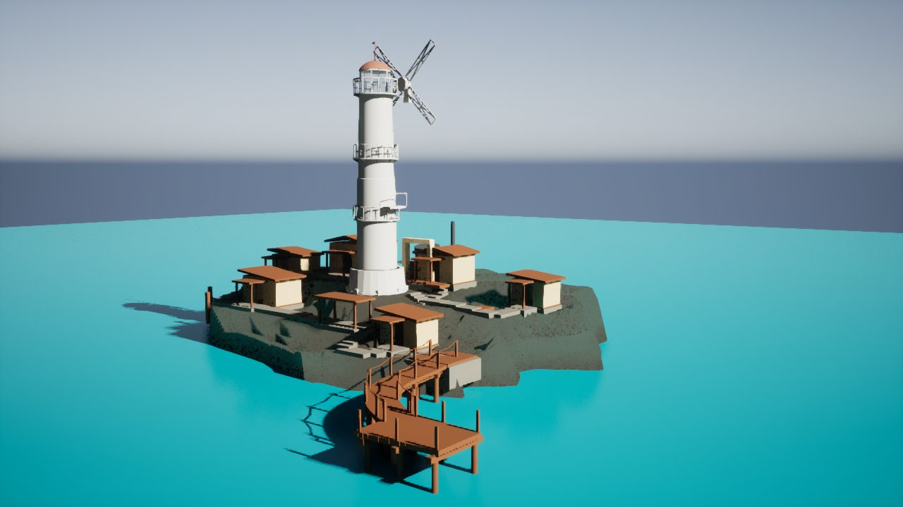 <b>G012 · HERO</b> — settlement density and lighthouse hierarchy.</td>
<td width="50%">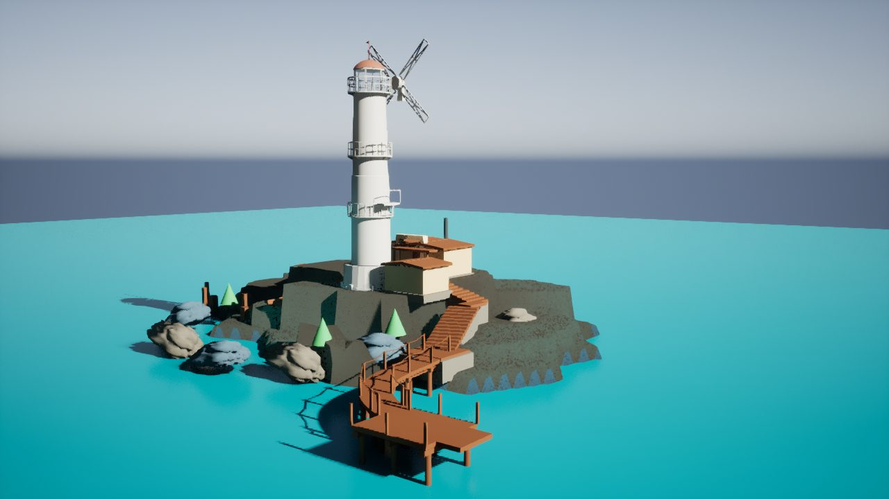 <b>G004 · source provenance</b> — comparison frame; not current final art.</td>
</tr>
</table>

 <b>Convergence trace:</b> G010 → G011 → G012 under matched review cameras. G010/G011 were not retained.

## 02 · Actual UE integration case study

<a href="process/07-world-art-002-real-ue-engineering.md">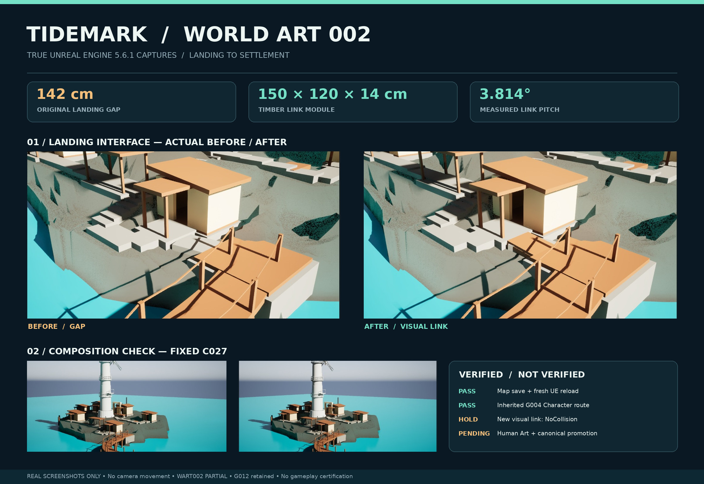</a> 
<b>World Art 002:</b> actual isolated UE integration and measured visual landing connection. This candidate was <b>not promoted</b>; new visual link had <b>NoCollision</b>.

<table>
<tr>
<td width="50%"><a href="process/07-world-art-002-real-ue-engineering.md">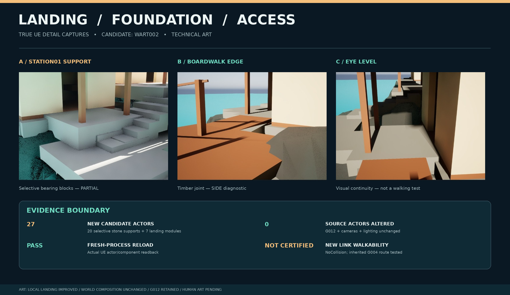</a> <b>Interface review</b> — building foundation, timber, route context and stated test boundaries.</td>
<td width="50%"><a href="process/07-world-art-002-real-ue-engineering.md">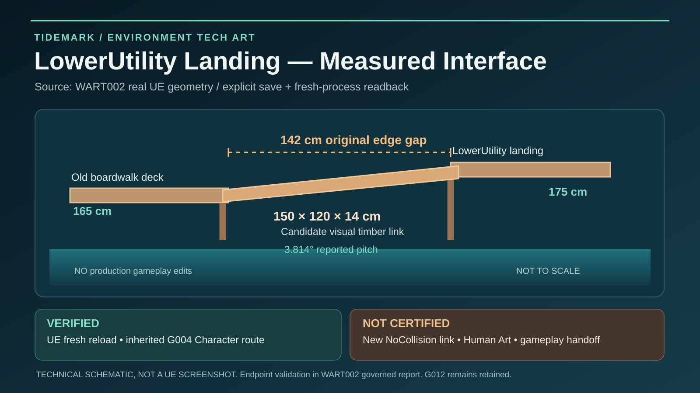</a> <b>Measured interface</b> — engineering schematic; not an engine render.</td>
</tr>
</table>

## 03 · Real Blender / technical research boards

<a href="process/06-real-engineering-boards.md">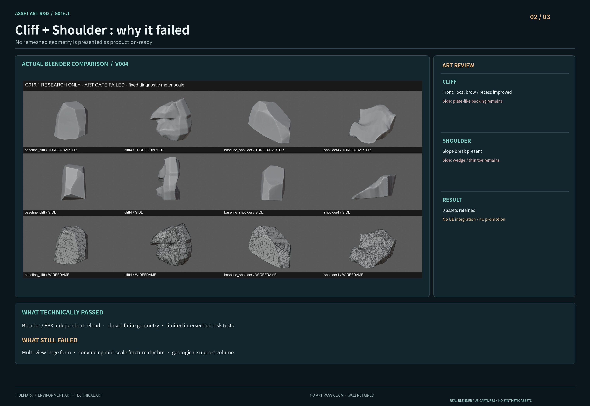</a> <b>Cliff & shoulder:</b> actual Blender studies. Not art-retained; planar cuts and difficult coast silhouettes remain visible.

<table>
<tr>
<td width="50%">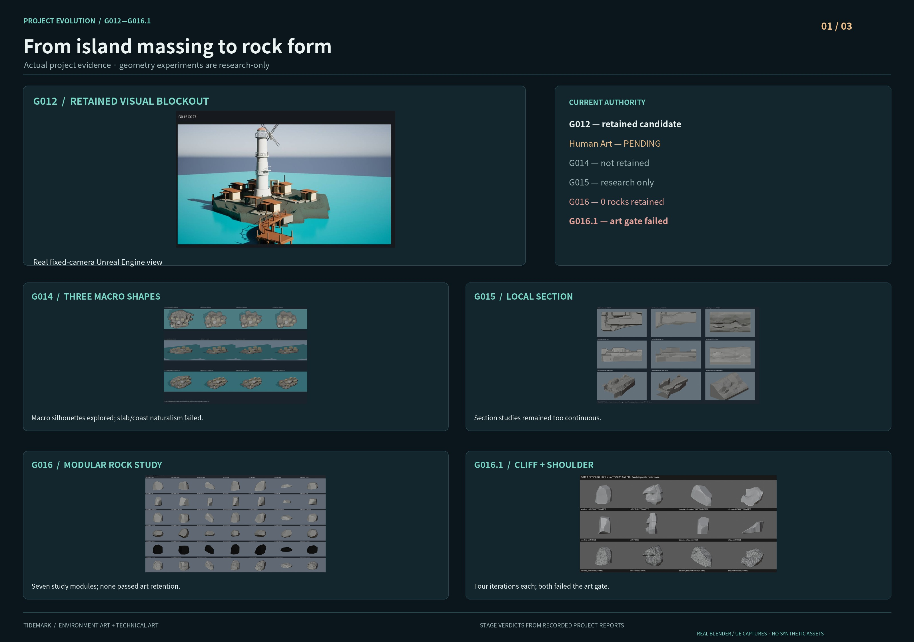 <b>Process timeline</b> — staged scene and geometry work.</td>
<td width="50%">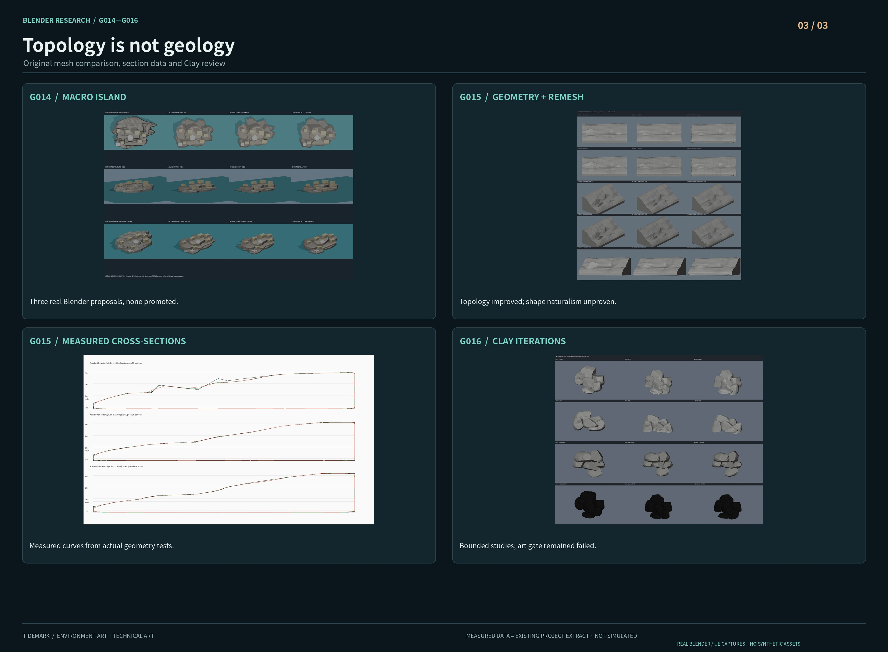 <b>Geometry evidence</b> — clay, sections and technical checks.</td>
</tr>
</table>

## 04 · October source-resolution additions

These four additions were exported from original local evidence, **not enlarged from contact-sheet thumbnails**. Existing G012, WART002 and Blender boards above are reused rather than uploaded again. JPEG copies are metadata-cleaned; original research evidence is unchanged. [Publication manifest](../media/showcase/2026-10/MANIFEST.json).

### World Art Reconstruction 001 — real UE, partial / not retained

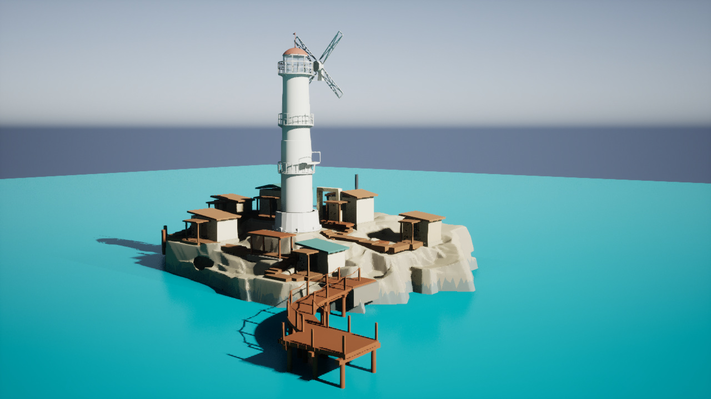 <b>HERO, 1280 × 720 source.</b> Local coast and settlement experiment. Visible changes did not resolve platform-like coast geometry. This is not the retained scene and not final environment art.

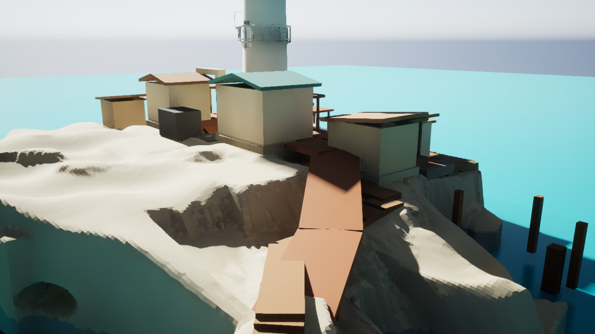 <b>Adverse view, 1280 × 720 source.</b> The broad rear terrace, hard coast cuts and crude access geometry explain why the candidate remained PARTIAL / not retained. Save/reload success did not override the art gate. G012 remains retained.

### Pipeline audit — diagrams and design previews, not engine output

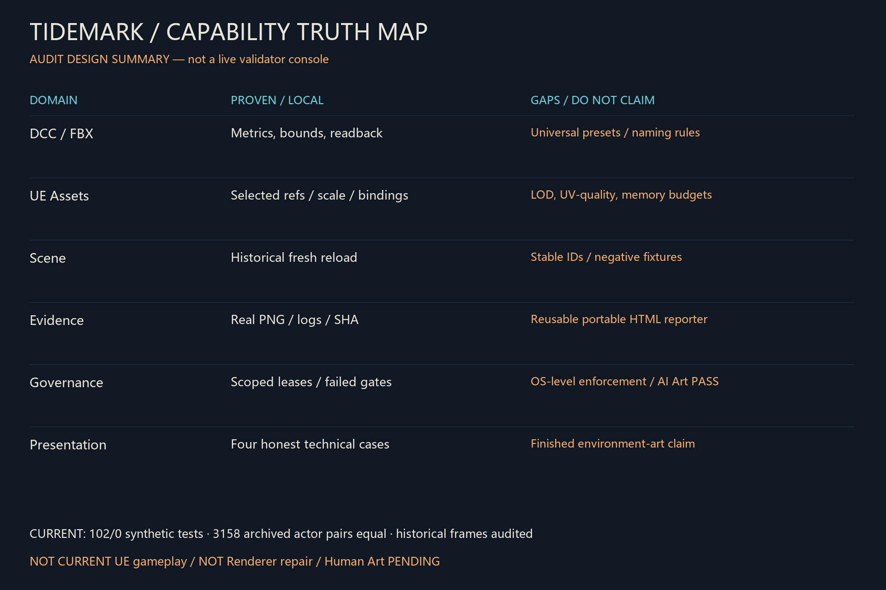 <b>Technical audit diagram, 1920 × 1280 source.</b> The 102/0 count is a standalone synthetic-core test; 3,158 equal actor pairs refer to offline rechecking of archived observations. Neither is a new UE run or a Renderer repair.

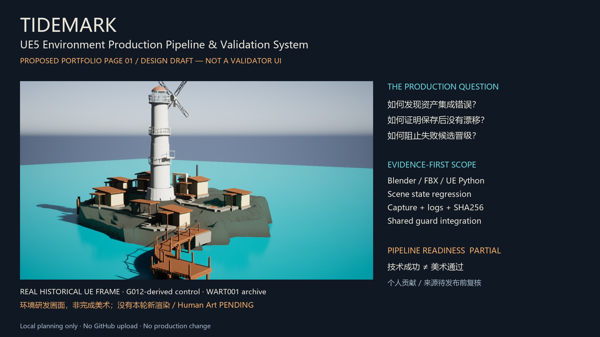 <b>Presentation design draft, 1920 × 1080 source.</b> An archived real UE frame paired with proposed pipeline messaging. This is a page-layout proposal, not a shipped tool interface or a new scene render.

No unlicensed concept reference, private source package, machine path, account details or agent log is included. No finished rock kit, universal Validator or Human Art approval is claimed.

## Pipeline & validation story

The October engineering audit (`TIDEMARK_PIPELINE_PORTFOLIO_AUDIT_001`, 2026-10-15) concluded **PIPELINE_READINESS = PARTIAL**: reusable evidence exists, but a unified environment validator has **not** been implemented.

| Verified or evidenced in scope | Boundary |
| --- | --- |
| Blender → FBX → UE coordinate correction | Proven on a bounded research import path; not a universal preset |
| Sampled foundation contact diagnostics | Sparse samples; no full bearing/collision certification |
| Explicit UE save → fresh-process actor ledger | Historical genuine UE run; current audit was offline replay |
| Camera captures, logs and hash manifests | Valid assets and evidence do not imply Renderer or art PASS |
| Protected candidate isolation and rejection | WART001 / WSR002 / WFD001 / WCB001 are research failures/partials, **not** approved art |

**Engineering status update:** Scene Comparator offline v1 has passed bounded synthetic/negative tests (53/53 expected outcomes). The real UE Ledger Bridge is **PARTIAL**: five ActorGuids survived one isolated save/reload, but component identity and non-primitive collision semantics blocked strict integration (INVALID / exit 2). Evidence Reporter and a production UE validator are **not** implemented. Visual design research and production approval remain separate.

### Review links

- [Main showcase](../README.md)
- [UE landing/interface case study](process/07-world-art-002-real-ue-engineering.md)
- [Real Blender research boards](process/06-real-engineering-boards.md)
- [Current public project status](status.md)
- [Technical overview](technical-overview.md)

---

Publication policy: no private evidence dumps, raw project packages, confidential logs, credentials or unreviewed third-party concept art. Image captions distinguish real runtime images, diagrams, archives and unapproved candidates. Additional October source images can be added only after local source/rights verification.
